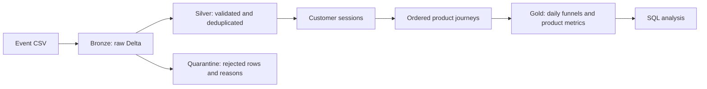

# E-commerce Customer Behaviour Analytics

A Python, SQL, PySpark, and Delta Lake personal project for exploring customer journeys,
product interactions, and conversion funnels at millions-of-events scale. Pytest validates
transformation contracts and actual Delta writes; GitHub Actions runs those checks on pushes
and pull requests.

**Data provenance:** no original customer dataset was supplied. Included generation produces
synthetic events, not measured business results. A 2.7-million-event synthetic benchmark can
exercise the pipeline; use your real dataset before reporting real customer insights.
See [the local validation record](docs/validation.md) for the tested workload and its limits.



## Quick start

Requires Python 3.10–3.13 and Java 17 or 21. Tested dependencies are pinned in `pyproject.toml`.
Local Spark downloads the Delta JVM artifacts from Maven Central on first use; allow
`repo.maven.apache.org` and `repo1.maven.org` in addition to PyPI.

```bash
python -m venv .venv
source .venv/bin/activate
python -m pip install -e '.[dev]'
export SPARK_LOCAL_IP=127.0.0.1
ecommerce-analytics generate --output data/demo.csv --rows 10000
ecommerce-analytics run --input data/demo.csv --output output/demo
ruff check .
pytest -q
```

The generator refuses to overwrite existing data. Reuse its CSV to rerun the pipeline.
If JVM artifact downloads cannot use your network proxy, prefetch verified jars with Python:

```bash
export SPARK_DELTA_JARS="$(python scripts/fetch_delta_jars.py --directory /tmp/ecommerce-delta-jars)"
```

This uses normal HTTPS verification and Maven Central's published artifact checksums.
Set the same variable for subsequent tests and CLI commands; the jar cache is reusable.

The pipeline **replaces the complete output tables** with each run. Always pass the complete
event corpus, use a dedicated output directory, and keep input and output separate. This is
a batch/full-refresh project, not an incremental or streaming ingestion system. Each Delta
table commits atomically, but a whole run is not a multi-table transaction: a failed run can
leave outputs from different runs, so consume results only after successful completion.

## Input contract

CSV files require a header. A file, directory, or Spark-supported glob can be supplied.
The schema follows [Retailrocket e-commerce events](https://www.kaggle.com/datasets/retailrocket/ecommerce-dataset):

| Field | Meaning |
| --- | --- |
| `timestamp` | 13-digit Unix epoch milliseconds, or an ISO timestamp; UTC is used |
| `visitorid` | Customer identifier, retained as a string |
| `event` | `view`, `addtocart`/`cart`, or `transaction`/`purchase` |
| `itemid` | Product identifier, retained as a string |
| `transactionid` | Optional transaction identifier |

Missing customer/product IDs, malformed timestamps, and unknown event types are quarantined
with reasons. Malformed CSV structure fails ingestion instead of silently dropping rows.
Silver deduplicates on a SHA-256 hash of normalized customer, product, timestamp, event type,
and transaction ID. Legitimate identical events at the same timestamp cannot be distinguished
without a source event identifier. Purchase events are item interactions, not distinct orders.
No prices or quantities are available, so this project does not calculate revenue or AOV.

Download real data separately and comply with its license. The pipeline needs only `events.csv`;
item property and category files are optional future enrichments. No Kaggle credentials are
needed to run synthetic examples or tests.

## Analytics definitions and Delta tables

A session ends when the next event for that customer arrives **more than 30 minutes** later.
The threshold is configurable using `--session-minutes`. Exactly 30 minutes stays in one
session. IDs are stable for the same complete corpus; adding earlier events can change sessions.

Conversion requires a view, a subsequent cart, and a subsequent purchase for the **same product
in the same session**. Nondecreasing timestamps count; equal timestamps have no reliable
source ordering. Purchases before the qualifying cart do not count as funnel conversions.
Daily metrics attribute the whole journey to its session start date in UTC, including sessions
crossing midnight. A session contributes at most once to each daily funnel stage.

| Output under `--output` | Contents |
| --- | --- |
| `bronze/events` | Raw CSV fields |
| `silver/events` | Valid unique canonical events, partitioned by event date |
| `silver/quarantine` | Rejected raw records and reasons |
| `gold/session_events` | Event-to-session assignments, partitioned by event date |
| `gold/sessions` | Durations, event counts, product breadth, stage counts |
| `gold/session_products` | Ordered stage timestamps per session/product |
| `gold/daily_funnel` | Eligible session counts and conversion rates |
| `gold/product_metrics` | Product interaction and ordered conversion counts |

Daily view-to-cart rate = carted sessions / viewed sessions; cart-to-purchase rate = converted
sessions / carted sessions. NULL rates indicate an empty denominator. Gold product metrics
count session/product pairs. `sql/customer_behaviour.sql` provides repeat-customer, product
conversion, and cart abandonment queries. The executable daily SQL is `DAILY_FUNNEL_SQL` in
`src/ecommerce_analytics/pipeline.py` and is covered by tests.

## 2.7-million-event synthetic workload

```bash
ecommerce-analytics generate --output data/synthetic-2700000.csv --rows 2700000 --seed 42
export PYSPARK_SUBMIT_ARGS='--driver-memory 4g pyspark-shell'
ecommerce-analytics run --input data/synthetic-2700000.csv \
  --output output/synthetic-2700000 --master 'local[4]' --shuffle-partitions 16
python scripts/validate_outputs.py --output output/synthetic-2700000 \
  --expected-valid-rows 2700000
```

Generation streams to disk and transformations stay distributed. Spark collects only scalar
quality counts and summaries on the driver. Size the cluster, driver/executor memory, and
shuffle partitions to fit real data; the sample command is a local demonstration, not a
production cluster sizing recommendation. Generated data and Delta outputs are Git-ignored.

## Databricks

1. Build a wheel: `python -m pip wheel --no-deps . -w dist`.
2. Upload it to a Unity Catalog Volume and install it as a notebook/cluster library with
   `--no-deps`, retaining Databricks' managed PySpark and Delta packages. Use a runtime with
   Spark 4.0 and Delta 4.0 compatibility; local versions are PySpark 4.0.1 and Delta 4.0.1.
3. Import `notebooks/databricks_pipeline.py` as a Python source notebook.
4. Set its `input_path`, `output_path`, and `session_minutes` widgets. The cluster identity
   needs read access to the source Volume and write access to the destination.
5. Run all cells. The notebook uses the runtime's existing `spark` session and registers
   temporary Gold views. Run the SQL examples against those views in the same session.

No Databricks deployment or cloud credentials are embedded. Databricks execution requires
your own workspace and compute; local Spark exercises the same transformation code.

## Automated validation

`pytest -q` checks aliases and timestamps, quarantine reasons, deduplication, stable session
boundaries, ordered funnels, cross-product exclusion, expected conversion rates, empty/invalid
data failures, synthetic generation, actual Delta tables, and repeatable full refreshes.
GitHub Actions installs the dependencies, runs Ruff and Pytest, and uploads its test report.
It does not deploy to Databricks. CI success and cloud execution must be verified separately.
